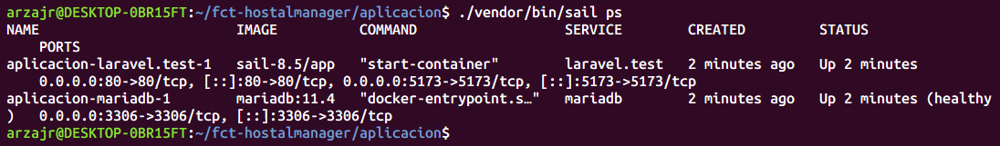
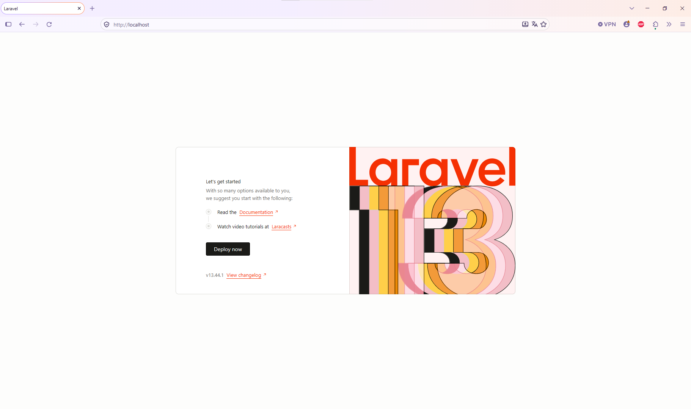

# Instalación y entorno de HostalManager

HostalManager se ejecuta en un entorno local de desarrollo con Ubuntu en WSL y Docker Desktop. Laravel Sail gestiona dos servicios definidos en `aplicacion/compose.yaml`.

| Servicio | Función | Entorno utilizado |
|---|---|---|
| `laravel.test` | Ejecuta la aplicación Laravel 13 y atiende las peticiones del navegador. | PHP 8.5 |
| `mariadb` | Almacena los datos de la aplicación. | MariaDB 11.4 |

## 1. Creación inicial de la aplicación

Creé la aplicación desde la raíz del repositorio utilizando un contenedor temporal de Composer. El directorio de trabajo de Ubuntu se montó en `/proyecto` dentro del contenedor, por lo que los archivos generados quedaron guardados en `aplicacion/`.

```bash
cd ~/fct-hostalmanager && docker run --rm \
  --user "$(id -u):$(id -g)" \
  --volume "$PWD:/proyecto" \
  --workdir /proyecto \
  composer:2 create-project laravel/laravel aplicacion "^13.0"
```

Este comando se ejecutó una sola vez al crear el proyecto. La plantilla de Laravel quedó registrada en el commit `febe555`.

## 2. Instalación de Laravel Sail

Desde la carpeta de la aplicación, añadí Sail como dependencia de desarrollo mediante Composer.

```bash
cd ~/fct-hostalmanager/aplicacion && docker run --rm \
  --user "$(id -u):$(id -g)" \
  --volume "$PWD:/proyecto" \
  --workdir /proyecto \
  composer:2 require --dev laravel/sail
```

Composer instaló Sail 1.71.0 y registró la versión en `composer.lock`.

## 3. Configuración de Laravel y MariaDB

Desde `~/fct-hostalmanager/aplicacion`, ejecuté Artisan para generar el archivo `compose.yaml` e incluir MariaDB como servicio de base de datos.

```bash
docker run --rm \
  --user "$(id -u):$(id -g)" \
  --volume "$PWD:/proyecto" \
  --workdir /proyecto \
  --entrypoint php \
  composer:2 artisan sail:install --with=mariadb
```

En `compose.yaml`, cambié la imagen generada `mariadb:11` por `mariadb:11.4` para utilizar la versión prevista en el diseño. Comprobé las imágenes configuradas con:

```bash
docker compose config --images
```

La salida mostró `mariadb:11.4` y `sail-8.5/app`. El servicio de MariaDB incluía la comprobación `healthcheck.sh --connect --innodb_initialized`, que verifica que el servidor acepta conexiones y que InnoDB ha terminado de inicializarse.

## 4. Primer arranque del entorno

Con Docker Desktop en ejecución, inicié los servicios desde la carpeta de la aplicación. La opción `-d` deja los contenedores funcionando en segundo plano.

```bash
cd ~/fct-hostalmanager/aplicacion
./vendor/bin/sail up -d
```

En el primer arranque, Docker construyó la imagen de Laravel, descargó la de MariaDB y creó la red `aplicacion_sail` y el volumen `aplicacion_sail-mariadb`. La red permite la comunicación entre los servicios y el volumen conserva los datos de MariaDB.

Comprobé el estado de los contenedores con:

```bash
./vendor/bin/sail ps
```

El servicio `laravel.test` apareció como `Up`, con el puerto 80 publicado en el equipo. MariaDB apareció como `Up (healthy)`.



## 5. Migraciones iniciales y acceso desde el navegador

Con los contenedores en ejecución, apliqué las migraciones iniciales de Laravel. Estas crean las tablas que necesita el framework, entre ellas `sessions`.

```bash
./vendor/bin/sail artisan migrate
```

Abrí `http://localhost` en el navegador y comprobé que se mostraba la página de bienvenida de Laravel.



## Estado de la verificación

Esta secuencia se verificó en el entorno donde se creó la aplicación. Queda pendiente ensayar la instalación desde un clon limpio y completar los pasos para recuperar las dependencias y preparar el archivo `.env` a partir de `.env.example`.